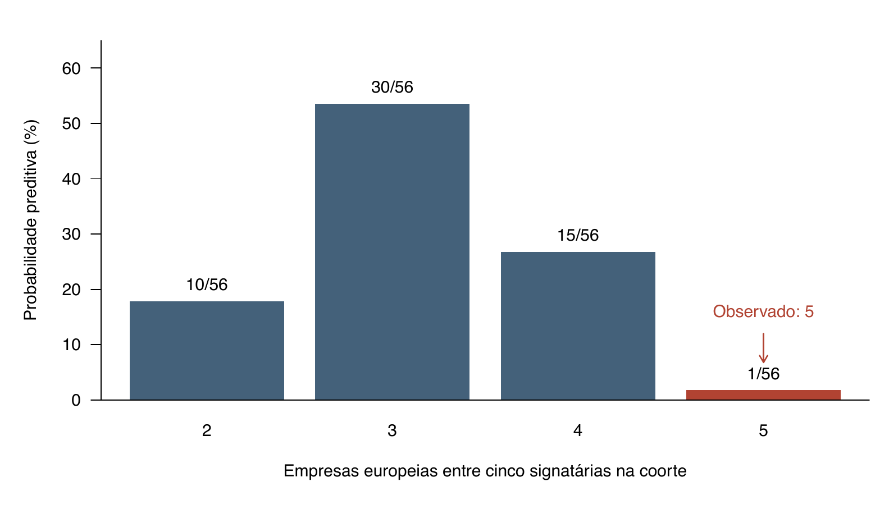

# O que este exemplo resolve

O protocolo anterior ainda deixava aberta a passagem decisiva: por que uma fonte justificaria uma probabilidade específica? Aqui executamos um exemplo completo com **contagens reais**, um modelo probabilístico declarado, posterior calculada e PPC exato. As probabilidades de resposta não são preenchidas por especialistas: são inferidas dos dados sob as suposições do modelo.

O objeto verificável é a adesão de empresas a uma carta sobre precificação de carbono. O PPC avalia uma especificação observacional de adesão homogênea. **Não estima nem valida automaticamente a probabilidade de uma motivação privada.** Essa distinção é necessária para identificar o que pode ser obtido das fontes e o que continua dependendo de hipóteses adicionais.

O exemplo é retrospectivo: a carta já é conhecida, e o padrão regional orientou a escolha da discrepância nesta demonstração. O resultado é um diagnóstico exploratório, não teste confirmatório previamente especificado. A carta antecede o Acordo de Paris; utilizar a coorte do artigo não equivale a replicar sua análise posterior ao acordo nem a transferir probabilidades de hipóteses de outro exercício. Cálculos foram executados em R por enumeração de todos os resultados possíveis; não há erro de simulação.

# Fonte, unidade, codificação e denominador

Vormedal, Gulbrandsen e Skjærseth estudam oito empresas: BP, Shell, Total, Eni, Equinor, ExxonMobil, Chevron e ConocoPhillips. A coorte foi retirada da introdução e da seção de dados do artigo. A carta a Christiana Figueres e Laurent Fabius, datada de 29/05/2015 e divulgada em 01/06/2015, identifica suas signatárias em uma lista completa. [Artigo disponibilizado pela autora](https://www.researchgate.net/publication/344002092_Big_Oil_and_Climate_Regulation_Business_as_Usual_or_a_Changing_Business); [carta primária, p. 3](https://totalenergies.com/sites/g/files/nytnzq111/files/atoms/files/letter_to_christiana_figueres.pdf); [comunicado de divulgação](https://totalenergies.com/newsroom/oil-and-gas-majors-call-carbon-pricing/?lang=eng).

Definimos $Y_i=1$ quando a empresa da coorte aparece entre as signatárias e $Y_i=0$ quando não aparece. A lista também contém BG, que não pertence à coorte. Equinor aparece sob seu nome da época, Statoil, correspondência explicitada no próprio artigo. Europa inclui Reino Unido e Noruega; não significa União Europeia.

\keepblock{17\baselineskip}

**Tabela 1. Dados codificados para uma única carta.** Zero significa ausência da lista de signatárias; não significa oposição à precificação, recusa de convite ou ausência de motivo econômico.

| Empresa da coorte | Região | Assina esta carta? |
|---|---|---:|
| BP | Europa | 1 |
| Shell | Europa | 1 |
| Total | Europa | 1 |
| Eni | Europa | 1 |
| Statoil / Equinor | Europa | 1 |
| ExxonMobil | EUA | 0 |
| Chevron | EUA | 0 |
| ConocoPhillips | EUA | 0 |

Da junção entre coorte e lista de signatárias obtemos, sem atribuir probabilidades causais:

$$n=8,\quad k=5,\quad k/n=0{,}625;\qquad
\bar Y_{\mathrm{Europa}}=1,\quad\bar Y_{\mathrm{EUA}}=0.$$

São oito posições empresariais em **um episódio coordenado**. A fonte não demonstra igualdade de convites, oportunidades, custos de adesão ou participação na negociação. Essas ausências serão relevantes para avaliar o modelo.

# Primeira decisão de julgamento: qual distribuição gera a lista?

Começamos com uma especificação deliberadamente simples, $M_0$:

$$Y_i\mid\theta,M_0\overset{\mathrm{ind}}{\sim}\operatorname{Bernoulli}(\theta),\qquad i=1,\ldots,8.$$

Sob esse modelo, todas as empresas têm a mesma propensão de adesão; condicionalmente a essa propensão, suas decisões são independentes. A região não altera a distribuição. **Homogeneidade e independência são suposições do analista, não fatos extraídos da carta.** A coordenação da iniciativa é uma razão substantiva para desconfiar delas. O propósito do PPC é verificar o que essa especificação deixa de reproduzir.

O parâmetro $\theta$ representa uma propensão dentro do processo hipotético de formação da lista descrito por $M_0$. Uma réplica é outra lista que esse processo poderia produzir para as mesmas oito empresas. Não é um discurso gerado artificialmente nem a afirmação de que podemos repetir literalmente a história.

Adotamos, para completar o modelo:

$$\theta\mid M_0\sim\operatorname{Beta}(1,1).$$

Essa distribuição uniforme é uma **escolha ilustrativa explícita de prior**. Não foi obtida das fontes nem elicitada de especialistas, e não é uma escolha sem conteúdo. Mais adiante mostramos que o principal diagnóstico não depende desse prior particular.

# Dos dados ao posterior: de onde sai cada número

Para o vetor observado, a likelihood é proporcional a:

$$p(y\mid\theta,M_0)=\theta^5(1-\theta)^3.$$

Os expoentes 5 e 3 vêm das assinaturas e ausências. Os parâmetros unitários abaixo vêm do prior. Pela conjugação beta-Bernoulli:

$$\theta\mid y,M_0\sim\operatorname{Beta}(1+5,1+3)
=\operatorname{Beta}(6,4).$$

Logo:

$$E(\theta\mid y,M_0)=\frac{6}{6+4}=0{,}60.$$

**O 0,60 é calculado, não retirado de uma frase da fonte.** Ele resulta da contagem 5/8, do modelo homogêneo e do prior declarado. Não é $P(H_{SA}\mid y)$ nem $P(H_{CA}\mid y)$. A propensão documental e a probabilidade de uma hipótese causal são objetos diferentes.

\keepblock{16\baselineskip}

**Tabela 2. Auditoria dos insumos.** Cada origem tem alcance distinto.

| Número ou condição | Origem |
|---|---|
| Oito empresas e sua região | Coorte e classificação do artigo |
| Cinco assinaturas; três ausências | Correspondência com lista integral da carta |
| Uma probabilidade comum; independência condicional | Suposições do modelo $M_0$ |
| Beta(1,1) | Prior escolhido para a demonstração |
| Beta(6,4) e média 0,60 | Consequências matemáticas dos dados, modelo e prior |
| Comparar separação regional | Escolha diagnóstica retrospectiva do analista |
| Probabilidade de uma motivação privada | Não identificada por essas contagens |

# Como gerar $y^{rep}$ e fazer o PPC

Em cada réplica, o procedimento é:

1. Sortear **um único** $\theta^{(s)}\sim\operatorname{Beta}(6,4)$.
2. Gerar oito adesões condicionais a esse mesmo valor: $Y_i^{rep,(s)}\sim\operatorname{Bernoulli}(\theta^{(s)})$.
3. Comparar a separação regional na lista replicada com a observada.

O sorteio comum importa: depois de integrar $\theta$, as respostas preditivas têm dependência por compartilharem a incerteza do parâmetro. Não se deve sortear um $\theta$ independente para cada empresa, pois isso muda a distribuição conjunta.

```r
theta_rep <- rbeta(1, 6, 4)
y_rep <- rbinom(8, size = 1, prob = theta_rep)
```

Escolhemos a discrepância:

$$T(y)=\left|\bar Y_{\mathrm{Europa}}-\bar Y_{\mathrm{EUA}}\right|.
\qquad T(y_{obs})=|1-0|=1.$$

É mais informativo checar essa concentração que apenas o total de assinaturas, porque a soma já foi usada para ajustar $\theta$. Existem $2^8=256$ vetores possíveis. Enumeramos todos, em vez de simular. Para um vetor específico com $k^{rep}$ assinaturas:

$$p(y^{rep}\mid y,M_0)=\frac{B(6+k^{rep},4+8-k^{rep})}{B(6,4)}.$$

Aqui não há coeficiente binomial: cada termo corresponde a um vetor rotulado de empresas. Para obter a probabilidade de uma contagem, somar os vetores com aquela contagem.

Apenas dois vetores têm discrepância igual ao máximo observado: todas as europeias assinam e nenhuma americana; ou o inverso. Portanto:

$$\begin{aligned}
p_{PPC}&=P\{T(Y^{rep})\ge1\mid y,M_0\}\\
&=\frac{B(11,7)+B(9,9)}{B(6,4)}\\
&=0{,}006005758947\approx0{,}60\%.
\end{aligned}$$

O resultado mostra que a distribuição conjunta especificada por $M_0$ produz raramente uma separação tão extrema. **Não é a probabilidade de $M_0$ ser verdadeiro**, nem uma rejeição de SA ou CA, nem um p-valor confirmatório calibrado para o processo retrospectivo de escolha deste exemplo.

# Uma conta ainda mais transparente: fixar cinco adesões

Podemos fazer uma checagem preditiva condicional: entre listas replicadas com exatamente cinco adesões, em quantas as cinco são europeias? Sob $M_0$, todos os subconjuntos de cinco das oito empresas têm a mesma probabilidade:

$$\binom85=56;\qquad
P\{T(Y^{rep})\ge1\mid y,M_0,K^{rep}=5\}=\frac1{56}=1{,}785714\%.$$

O vetor inverso tem três adesões, por isso não entra nesse condicionamento. O número 1/56 pode ser conferido por combinatória, sem conhecimento de Bayes. Nesta checagem, $\theta$, o prior e o posterior cancelam. Ela coincide com uma referência exata de permutação sob a simetria adotada; não constitui uma inovação especificamente Bayesiana.

\keepblock{12\baselineskip}

**Tabela 3. Distribuição condicional de adesões europeias.** Total de adesões na coorte fixado em cinco; denominador comum de 56 subconjuntos possíveis.

| Europeias que assinam | Americanas que assinam | Subconjuntos | Probabilidade |
|---:|---:|---:|---:|
| 2 | 3 | 10 | 17,8571% |
| 3 | 2 | 30 | 53,5714% |
| 4 | 1 | 15 | 26,7857% |
| 5 | 0 | 1 | 1,7857% |

{width=95%}

# Qual julgamento realmente controla a conclusão?

\keepblock{11\baselineskip}

**Tabela 4. Sensibilidade ao prior de $\theta$.** Mesmos oito dados e mesma discrepância; PPC usual bilateral.

| Prior | Posterior | Média posterior | $p_{PPC}$ |
|---|---|---:|---:|
| Beta(0,5; 0,5) | Beta(5,5; 3,5) | 0,611111 | 0,00579631 |
| Beta(1; 1) | Beta(6; 4) | 0,600000 | 0,00600576 |
| Beta(2; 2) | Beta(7; 5) | 0,583333 | 0,00632095 |

Há uma demonstração mais forte. Para qualquer $\theta$, definindo $u=\theta(1-\theta)\in[0,1/4]$:

$$P(T^{rep}=1\mid\theta,M_0)=u^3(1-2u)\le\frac1{128}=0{,}78125\%.$$

A expressão é crescente nesse intervalo, pois sua derivada é $u^2(3-8u)\ge0$. A cota também vale após integrar qualquer posterior de $\theta$. Assim, trocar somente o prior não permite a esse modelo reproduzir frequentemente o padrão observado.

**A estrutura conjunta é a suposição decisiva.** Para ver isso, considere uma construção matemática diferente: com probabilidade 1/2, só as cinco europeias assinam; com probabilidade 1/2, só as três americanas assinam. Toda empresa tem probabilidade marginal 1/2, mas $T=1$ sempre. Essa construção não é uma estimativa histórica; demonstra por que marginais iguais não determinam a distribuição conjunta. Coordenação específica por região pode mudar inteiramente o PPC.

# Revisar o modelo e delimitar a conclusão causal

Como revisão observacional ilustrativa $M_1$, permitir uma propensão para cada região, com priors Beta(1,1) independentes, produz:

$$\theta_E\mid y,M_1\sim\operatorname{Beta}(6,1),\qquad
\theta_U\mid y,M_1\sim\operatorname{Beta}(1,4).$$

As médias são $6/7=0{,}857143$ e $1/5=0{,}20$. Enumerando novamente os 256 vetores, obtemos $P(T^{rep}\ge1\mid y,M_1)=0{,}311750$, cerca de 31,18%. Isso mostra como introduzir heterogeneidade regional permite reproduzir o padrão. **Não valida $M_1$**, pois a revisão foi motivada e ajustada pelos mesmos dados. Tampouco distingue contexto institucional, coordenação, oportunidade de convite ou motivação econômica. Avaliar utilidade adicional exige evidência diferente e controle da flexibilidade introduzida.

O encaixe em BPT exige uma ligação substantiva adicional: por que uma hipótese causal implicaria determinada distribuição de adesões? Acomodação estratégica pode variar com ameaças regulatórias nacionais; vantagem competitiva pode variar com exposição ao gás; ambas podem depender da rede que organizou a carta. Nenhuma das duas hipóteses, por seu nome, implica decisões iid com probabilidade comum. Esse modelo não é atribuído a Fairfield e Charman nem a Vormedal e colegas.

Um próximo modelo poderia usar indicadores documentados de pressão regulatória, exposição econômica e convite/coordenação. Mesmo quando esses indicadores são mensuráveis, seus coeficientes, a direção causal e o transporte para outra oportunidade precisam de sustentação. Oito adesões em uma carta não identificam automaticamente esses componentes. Não preencheremos uma tabela de $P(Y\mid H_{SA})$ e $P(Y\mid H_{CA})$ como se ela fosse consequência das contagens.

**A resposta prática à passagem das fontes aos números é, portanto, precisa:** codificar um resultado observável e seu conjunto de oportunidades; formular uma distribuição conjunta; estimar os parâmetros que os dados informam; checar propriedades que a especificação pode deixar de reproduzir. No exemplo, os números foram obtidos assim. Para parâmetros causais que as fontes não identificam, permanecem julgamento explícito, restrições ou análise de sensibilidade. A etapa estatística está executada; a atribuição de motivos continua inconclusiva.

# Reprodução e verificações

Os arquivos `data/cohort.csv` e `data/signatories.csv` preservam as duas entradas documentais; `data/provenance.md` registra fontes, datas e decisões. A carta primária está arquivada em PDF e texto extraído no diretório `sources/`. `worked_example.R` faz a junção, identifica BG como fora da coorte, verifica a codificação, ausências e duplicidades, enumera os vetores e salva resultados em CSV. O manuscrito não foi modificado.

Verificações executadas: 256 vetores; probabilidades somando um; 56 vetores com cinco adesões; duas separações regionais máximas na distribuição geral e uma na condicional; concordância entre enumeração e integração numérica independente; sensibilidade a três priors; revisão matemática e interpretativa por outro agente. O gerador de Monte Carlo foi fornecido, mas os resultados reportados foram obtidos por enumeração exata.

Da raiz do projeto:

```sh
example_dir=quality_reports/research_pipeline/ppc_bpt
Rscript "$example_dir/2026-10-10_worked_example/worked_example.R"
```

O `README.md` lista resultados e comandos completos de reprodução. Não houve elicitação humana, estudo de calibração nem validação empírica de mecanismos.
