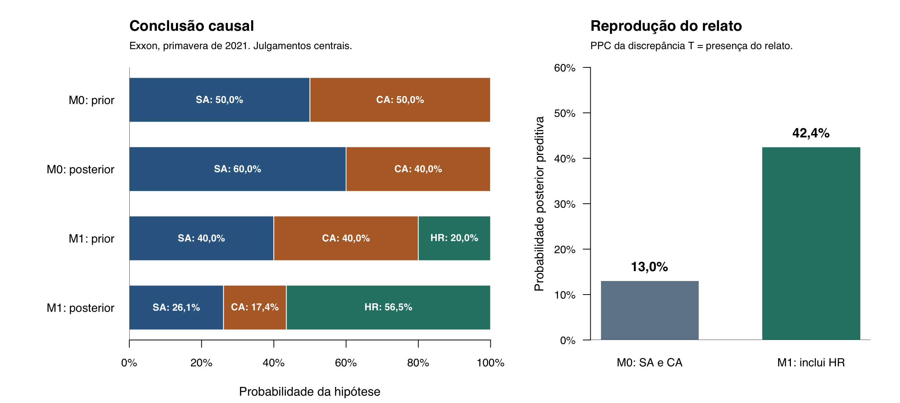

# 1. Resultado e pergunta substantiva

**A comparação binária atribui {{M0_SA}} a acomodação estratégica na aplicação local. Quando se inclui a motivação reputacional, sua posterior passa a {{M1_SA}}, a vantagem competitiva recebe {{M1_CA}} e a motivação reputacional, {{M1_HR}}. O PPC do relato observado passa de {{PPC0}} para {{PPC1}}.** Esses resultados são condicionais aos julgamentos apresentados nas Tabelas 2 e 3. A análise de sensibilidade mostra quais deles mudam a conclusão.

O objeto é o motivo principal do apoio da **ExxonMobil ao imposto federal sobre carbono na primavera de 2021**. A aplicação reúne a manifestação pública do CEO em março, uma entrevista de um diretor de relações governamentais em maio e a reação oficial em julho. Isso permite comparar posições públicas e um relato sobre a motivação no mesmo ator e período.

Usamos as hipóteses substantivas de Fairfield e Charman (FC), especializadas para esse episódio. **SA, acomodação estratégica**, significa aceitar uma política com custo econômico líquido para evitar alternativas regulatórias mais onerosas. **CA, vantagem competitiva**, significa apoiar a política pelo benefício econômico líquido esperado. **HR, ganhos reputacionais sem custo de adoção**, significa apoiar sobretudo porque a política é considerada inviável e o posicionamento traz benefícios reputacionais. FC já formulam HR no Apêndice A.3 e distinguem seu conteúdo causal das duas primeiras hipóteses. [Artigo e suplemento de FC](https://doi.org/10.1017/psrm.2025.16).

Na comparação restrita, a pergunta é qual dos dois motivos ligados à adoção explica melhor o registro. O PPC pergunta com que frequência esse registro apareceria se as hipóteses consideradas fossem adequadas. A expansão pergunta quanto apoio recebe a explicação reputacional quando ela também pode receber probabilidade.

## O ponto de partida publicado

A reprodução dos pesos de FC dá:

$$6-4-3+12-7=4\ \mathrm{dB},\qquad
P(SA\mid E_1,E_2,E_3,E_4)=\frac{10^{0,4}}{1+10^{0,4}}={{FC_SA_MATH}}.$$

Esse resultado abrange várias empresas e episódios de 2015–2019. A Tabela 1 conserva a unidade e os pesos publicados. A aplicação Exxon2021 faz uma inferência local com priors próprios. O anexo computacional da seção 6 também mostra um PPC completo dos quatro pacotes originais sob diferentes julgamentos de probabilidade absoluta.

\newpage

{{FC_TABLE}}

O financiamento incorporado a E3 inclui ação de 2018. Os pacotes são tratados como os enunciados compostos publicados. Seus componentes, empresas e notícias não são contados como observações intercambiáveis.

# 2. Das fontes aos códigos observados

**F1. Apoio público, 29/03/2021.** Darren Woods pede ao Congresso que adote o preço do carbono. Associa o instrumento a oportunidades tecnológicas e à substituição de regras custosas. O apoio público entra como condição conhecida, $C$. O texto fornece contexto para SA e CA. [Manifestação oficial](https://corporate.exxonmobil.com/news/viewpoints/supports-carbon-pricing).

**F2. Entrevista de maio, publicada em 30/06/2021.** Keith McCoy, diretor sênior de relações governamentais, descreve a utilidade comunicativa do apoio ao imposto e sua expectativa de inviabilidade. A reportagem originadora informa que o entrevistador se apresentou como recrutador. A pergunta sobre a inviabilidade também participa da formulação do relato. Codificamos $Q=1$: há uma ligação explícita entre utilidade instrumental do apoio e inviabilidade esperada. O código descreve a fala, cuja representatividade corporativa será avaliada nas likelihoods. [Reportagem e registro originadores](https://unearthed.greenpeace.org/2021/06/30/exxon-climate-change-undercover/).

**F3. Contraditório, 02/07/2021.** Woods desautoriza comentários gravados e reafirma a posição pública sobre o preço do carbono. Sua manifestação responde a um conjunto de falas do episódio. Codificamos $V=1$: houve desautorização formal, acompanhada de reafirmação do apoio. [Resposta oficial](https://corporate.exxonmobil.com/news/news-releases/statements/our-position-on-climate-policy-and-carbon-pricing).

O padrão observado é, portanto, **apoio público conhecido + relato instrumental ligado à inviabilidade + desautorização oficial**. Há um episódio de entrevista e uma reação dependente desse episódio. Os textos brutos, as extrações e os códigos estão preservados em `sources/` e `data/evidence_codebook.json`.

## Qual parte da explicação é examinada

A consequência causal examinada é esta: se o motivo principal é obter a adoção de uma política desejável, a fala de um representante informado deve refletir esse interesse com mais frequência do que apresentar o apoio como útil por sua inviabilidade. HR oferece uma explicação direta para a segunda possibilidade. A ordenação é informada pela distinção teórica de FC e pelo conteúdo do registro.

A avaliação do relato exige considerar conhecimento do interlocutor, franqueza, benefícios reputacionais secundários, cinismo individual e seleção jornalística. Esses fatores entram em $q_H=P(Q=1\mid H,C)$, definido **antes** de condicionar na resposta específica da empresa. A resposta tem seu próprio fator, $d_H=P(V=1\mid Q=1,H,C)$. A estrutura usada é:

$$P(Q,V\mid H,C)=P(Q\mid H,C)P(V\mid Q,H,C).$$

No modelo de observação, $V$ só é registrado como reação quando há $Q=1$. Quando $Q=0$, a reação fica fora desse ramo. O gerador tem três estados completos: ausência do relato, presença do relato sem desautorização, e presença do relato com desautorização.

Se a leitura de F2 for considerada insuficiente para codificar a ligação instrumental, a análise alternativa marca o relato como inconclusivo e omite a atualização pelo par $Q,V$. O arquivo de resultados registra essa opção e o retorno aos priors.

# 3. Das interpretações às probabilidades

**Os valores desta seção são julgamentos explícitos desta aplicação.** As likelihoods do relato foram propostas pelo leitor de fontes e adotadas pelo coordenador. Os priors e a parametrização da resposta corporativa foram escolhidos pelo coordenador. A elicitação foi retrospectiva, com os documentos conhecidos. A autoria de cada número, seu argumento e as alternativas estão em `data/judgment_ledger.csv`.

Table: Likelihoods do relato, condicionadas no apoio público e no contexto de obtenção da fonte. As porcentagens expressam os julgamentos desta aplicação, não frequências observadas.

| Hipótese | $P(Q=1\mid H,C)$ | Argumento para o julgamento | Valores examinados |
|:-----------|------------------------:|:----------------------------------------------|:---------------|
| SA | 15% | Um representante pode reconhecer valor reputacional e pessimismo político embora o objetivo principal seja uma alternativa regulatória preferível. | 5% a 40% |
| CA | 10% | O benefício econômico da adoção torna o relato que liga utilidade do apoio à inviabilidade menos central. Cinismo e baixa expectativa de aprovação continuam possíveis. | 5% a 40% |
| HR | 65% | A fala liga utilidade comunicativa e inviabilidade, que constituem o mecanismo de HR. Reserva-se probabilidade para outros relatos, silêncio e formulações mistas. | 40% a 80% |

**Como ler os números.** O compromisso SA de 15% equivale a aceitar que, em 100 repetições imaginadas do mesmo contexto de fonte e com SA operando, aproximadamente 15 produziriam um relato do tipo codificado. O compromisso HR de 65% expressa a expectativa de que esse relato seja usual sob HR. Os documentos sustentam os argumentos para essas comparações. A intensidade numérica da comparação é assumida pelo analista e submetida às variações da seção 5. A diferença 15% versus 10% é especialmente contestável, e a análise com likelihoods iguais está incluída.

Table: Priors e resposta institucional. Todos são julgamentos desta aplicação, condicionados em $C$.

| Entrada | Valor central | Compromisso assumido |
|:---------------------------|:---------------------------|:-------------------------------------------|
| Modelo $M_0$, com SA e CA | 50% para cada | Ponto de partida local equilibrado entre os dois argumentos presentes na manifestação pública. |
| Modelo $M_1$, com HR | 40% SA, 40% CA, 20% HR | Preserva a proporção SA:CA e admite HR com odds iniciais de 1:4 contra o conjunto antigo. |
| $P(V=1\mid Q=1,H,C)$ | 90% nas três hipóteses | Uma controvérsia desse tipo tende a provocar reafirmação oficial, tanto por discordância real como por defesa da reputação. |

A igualdade das probabilidades da resposta faz o contraditório ter peso relativo neutro no cálculo central. A seção 5 modifica esse julgamento: se a desautorização for menos esperada sob HR, ela reduz a posterior de HR. Os intervalos são análises de sensibilidade, sem distribuição uniforme ou ponderação implícita entre seus valores.

{{KERNEL_TABLE}}

Cada coluna soma 100%. A linha observada é a última. Sua probabilidade é $q_Hd_H$. A tabela mostra o gerador inteiro: todos os resultados possíveis e sua probabilidade sob cada hipótese.

# 4. Atualização, réplicas e PPC

No modelo inicial, as probabilidades da linha observada são 0,135 sob SA e 0,090 sob CA. Multiplicando pelos priors e normalizando:

$$P(SA\mid Q=1,V=1,C,M_0)
=\frac{0,5\times0,135}{0,5\times0,135+0,5\times0,090}=0,60.$$

A comparação binária favorece SA em {{M0_SA}}. **O check usa essa posterior**, mantendo a mesma tabela geradora. Escolhemos $T(Y)=1$ se a réplica contém o relato instrumental ligado à inviabilidade, qualquer que seja a resposta oficial. Como $T(Y_{obs})=1$, a cauda preditiva é:

$$p_{PPC,0}=P(T(Y^{rep})\geq1\mid Y_{obs},C,M_0)
=0,60\times0,15+0,40\times0,10=0,13.$$

Assim, {{PPC0}} das réplicas do modelo atualizado conteriam um relato desse tipo. É uma tensão moderada: entre SA e CA há uma vencedora, mas ambas atribuem baixa probabilidade ao aspecto do registro escolhido para o diagnóstico. Esse resultado não atinge uma referência de 5% e não sustenta uma rejeição decisiva.

## Como obter $Y^{rep}$ na prática

1. Sortear SA ou CA com probabilidades 0,60 e 0,40.
2. Sortear a presença de $Q$ com a probabilidade da hipótese sorteada.
3. Se $Q=1$, sortear a resposta $V$ com probabilidade 0,90. Se $Q=0$, encerrar nesse ramo.
4. Registrar o estado resultante e calcular $T$.

Por exemplo, uniformes $(0,40;0,11;0,70)$ selecionam SA, geram $Q=1$ e $V=1$. Uniformes $(0,40;0,40)$ selecionam SA e geram $Q=0$. São exemplos de execução da regra. **Os resultados entregues foram calculados por enumeração exata dos três estados**, que produz a distribuição completa sem erro de Monte Carlo. A operação bayesiana é a mesma descrita para modelos causais por [Humphreys e Jacobs, seção 16.1.2](https://integrated-inferences.github.io/book/16-evaluating-models.html).

## A conclusão depois de admitir HR

HR já tem conteúdo substantivo independente do resultado numérico: reputação associada a uma política percebida como inviável. Usando os priors da Tabela 3, atualizamos os três motivos com o **mesmo padrão observado**:

{{POSTERIOR_TABLE}}

O denominador da atualização é $0,054+0,036+0,117=0,207$. A nova probabilidade de HR é $0,117/0,207$ = {{M1_HR}}. O relato e a resposta são {{BF_R}} vezes mais prováveis sob HR que sob a combinação inicial de SA e CA. As odds iniciais de 1:4 tornam-se 1,3:1.

O PPC recalculado é:

$$p_{PPC,1}=0,26087\times0,15+0,17391\times0,10+0,56522\times0,65
=0,42391.$$

A nova distribuição reproduz a característica examinada em {{PPC1}} das réplicas. A probabilidade do padrão exato $Q=1,V=1$ passa de {{MASS0}} para {{MASS1}}. Essa massa é apresentada separadamente da cauda do check.

# 5. Quais julgamentos alteram a conclusão

{{SENSITIVITY_TABLE}}

Todas as linhas conservam as mesmas fontes e o mesmo código observado. Elas mudam apenas o julgamento indicado, em relação à referência central. A inclusão de HR lhe dá maioria central, mas essa maioria é sensível a alternativas substantivamente relevantes.

{width=95%}

## O limite que concentra a discussão substantiva

Seja $\pi$ a probabilidade inicial de SA dentro do conjunto SA/CA, $\rho$ a probabilidade inicial de HR e $\lambda=P(Q=1\mid HR,C)$. Com as mesmas probabilidades de resposta nas três hipóteses, seja $\bar q=\pi q_{SA}+(1-\pi)q_{CA}$. Para HR ter posterior maior que 50%, precisamos de:

$$\rho\lambda>(1-\rho)\bar q.$$

Com $\rho=0,20$ e $\lambda=0,65$, isso exige **$\bar q<0,1625$**. Na especificação central, $\bar q=0,125$. Portanto, a conclusão depende de considerar um relato como o de McCoy suficientemente incomum quando a motivação principal é obter a adoção. Se o contexto de entrevista, o cinismo individual ou a seleção jornalística elevarem essa probabilidade acima de 16,25%, HR perde a maioria, mantidos os demais valores.

Há dois outros limites úteis. Mantidas as likelihoods centrais, a massa inicial de HR precisa superar {{RHO_THRESHOLD}}. Mantidos os demais valores e uma resposta com probabilidade 90% sob SA/CA, HR só conserva maioria se a chance de desautorização sob HR superar {{DR_THRESHOLD}}. Assim, o contraditório também possui uma consequência numérica verificável.

Se $Q$ for recodificado como inconclusivo, o par dependente $Q,V$ é omitido dessa atualização. A posterior volta a 40%, 40% e 20%. Essa alternativa registra o efeito de discordar da mensuração, além de discordar dos números.

# 6. O que a aplicação permite concluir e reproduzir

**A conclusão local mais sustentada é que o apoio público da Exxon admite uma interpretação reputacional relevante, e que escolher somente entre SA e CA produz uma atribuição causal sensível à composição do conjunto de hipóteses.** Sob os julgamentos centrais, SA cai de {{M0_SA}} na comparação binária para {{M1_SA}} no modelo expandido. HR recebe {{M1_HR}}. A força dessa conclusão depende, sobretudo, da representatividade do relato e da massa inicial atribuída a HR.

O PPC avalia uma implicação compartilhada pelas explicações ligadas à adoção e explicita a tensão de {{PPC0}}. A atualização com HR mostra a consequência de ampliar a explicação causal. A melhora preditiva foi calculada sobre o mesmo episódio usado na revisão. A aplicação é um diagnóstico retrospectivo completo, com uma evidência discriminante, e não estabelece a superioridade futura do modelo expandido.

## PPC dos quatro pacotes originais de FC

Para tornar visível o problema de completar a previsão do caso publicado, calculamos também todas as 16 combinações de presença/ausência de E1–E4. Conservamos os Bayes factors publicados. Em cada análise, a hipótese favorecida pelo item recebe uma probabilidade absoluta $a$, e a rival recebe $a$ dividido pelo fator favorável. Admitimos independência condicional e uso das mesmas probabilidades em histórias não observadas. **Essas são escolhas adicionais desta auditoria**, além dos pesos publicados.

Com a posterior obtida dos quatro itens, ordenamos os 16 padrões pela massa preditiva e somamos as probabilidades dos padrões tão ou menos prováveis que o observado. Esse é o check conjunto desta auditoria.

{{FC_COMPLETION_TABLE}}

A posterior permanece idêntica porque as razões de likelihoods permanecem idênticas. O diagnóstico preditivo muda porque as probabilidades absolutas mudam. A aplicação permite apontar o julgamento responsável por um alarme e verificar se ele sobrevive a alternativas. Os resultados desta tabela pertencem ao conjunto agregado original, enquanto as Tabelas 2–6 pertencem ao episódio Exxon2021.

## Entrega reproduzível

O pacote preserva fontes HTML e PDF, extrações, códigos, julgamentos, scripts R, resultados CSV/RDS e revisões. `data/model_spec.json` contém todos os valores executados. Para adotar outro julgamento, copie o pacote, edite esse arquivo e execute os três scripts R na ordem do `README.md`. Revise também os argumentos e a interpretação no template antes de emitir um novo relatório. `scripts/build_report.py` importa os resultados e os formata, com uma trava que evita apresentar outros parâmetros como se fossem a aplicação central aqui descrita. A grade de {{GRID_N}} especificações fica disponível para inspeção, sem ser interpretada como distribuição de crenças.

A implementação e a revisão matemática foram realizadas por agentes distintos. A revisão reconstruiu as contas por fórmulas independentes. O manuscrito e seu suplemento foram preservados. Esta aplicação constitui material de desenvolvimento do método, com conclusões condicionais que o autor pode aceitar, modificar ou rejeitar alterando os compromissos da tabela de julgamentos.
